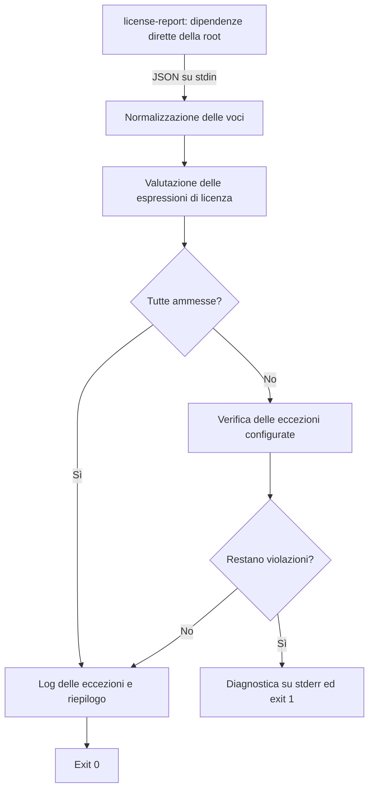

# Controllo delle licenze: `check-license-report.mjs`

[`bins/check-license-report.mjs`](../bins/check-license-report.mjs) applica la policy del repository alle licenze delle dipendenze presenti in un report JSON. Accetta un insieme esplicito di licenze, gestisce eccezioni circoscritte e termina con errore quando trova una violazione, facendo fallire il controllo automatico in CI.

Il comando da usare dalla root del repository è:

```bash
pnpm license:check
```

## A cosa serve

Il controllo rende visibili le dipendenze con licenze fuori dalla policy, incluse quelle usate nello sviluppo. Serve, per esempio, a intercettare una nuova dipendenza non ammessa oppure il cambio di licenza di una dipendenza già utilizzata.

Le responsabilità sono divise tra due programmi:

| Componente                 | Responsabilità                                                                                      |
| -------------------------- | --------------------------------------------------------------------------------------------------- |
| `license-report`           | Raccoglie i metadati delle dipendenze e produce il report JSON.                                     |
| `check-license-report.mjs` | Legge il report, valuta licenze ed eccezioni, stampa l'esito e determina il successo del controllo. |

Lo script è un modulo JavaScript ESM, eseguito direttamente con Node.js: non richiede compilazione TypeScript e importa soltanto moduli standard di Node. Legge lo standard input e, quando deve valutare un'eccezione, i manifest del repository. Non modifica file e non effettua chiamate di rete; il produttore `license-report` consulta anche il registry npm e può quindi richiedere accesso alla rete.

## Dove e come lo usiamo

### Comando del repository

Nel [`package.json` principale](../package.json), lo script `license:check` è definito così:

```json
{
  "license:check": "license-report --output=json --only=prod,dev,opt,peer | node bins/check-license-report.mjs"
}
```

La pipe passa l'output JSON di `license-report` allo standard input del verificatore. L'opzione `--only` include questi campi del manifest analizzato:

| Valore | Campo del `package.json` |
| ------ | ------------------------ |
| `prod` | `dependencies`           |
| `dev`  | `devDependencies`        |
| `opt`  | `optionalDependencies`   |
| `peer` | `peerDependencies`       |

`license-report` è una `devDependency` della root, dichiarata con `catalog:`. La versione è gestita nel catalogo di [`pnpm-workspace.yaml`](../pnpm-workspace.yaml), attualmente con intervallo `^6.8.6`, e risolta nel lockfile.

**Perimetro effettivo:** il comando viene eseguito dalla root senza l'opzione `--package`. Nella versione 6.8.6, `license-report` legge quindi il `package.json` principale e ne elenca le dipendenze dirette. Il comando attuale non aggrega i manifest dei package workspace e non percorre ricorsivamente le dipendenze transitive. Anche la presenza di una voce nel catalogo pnpm, da sola, non la aggiunge al report.

### GitHub Actions

Il workflow [`Security Audit`](../.github/workflows/security.yml) contiene il job `license-check`, visualizzato come **License Compliance**. Il job:

1. Esegue il checkout del repository.
2. Richiama l'action locale [`setup-ci`](../.github/actions/setup-ci/action.yml), che configura Node.js e pnpm e installa le dipendenze con `--frozen-lockfile --ignore-scripts`.
3. Esegue `pnpm license:check`.

Il job gira su `ubuntu-latest`, ha un timeout di 15 minuti e non usa `continue-on-error`: una violazione fa fallire il job.

Il workflow parte nei seguenti casi:

| Evento              | Condizioni                                           |
| ------------------- | ---------------------------------------------------- |
| `push`              | Sul branch `main`, per i percorsi monitorati.        |
| `pull_request`      | Verso `main` o `develop`, per i percorsi monitorati. |
| `schedule`          | Ogni lunedì alle 09:00 UTC.                          |
| `workflow_dispatch` | Avvio manuale da GitHub Actions.                     |

I percorsi monitorati per push e pull request sono `package.json`, `pnpm-lock.yaml`, `pnpm-workspace.yaml`, `**/package.json`, `.github/actions/**` e `.github/workflows/**`. Una modifica al solo `bins/check-license-report.mjs` non attiva questo workflow tramite i filtri attuali: per verificarla occorre eseguire il comando localmente o avviare il workflow manualmente.

Il controllo delle licenze è separato dal job `Dependency Audit`, che esegue `pnpm audit` per le vulnerabilità. Non è richiamato da `pnpm build`, `pnpm test` o `pnpm validate:all`, e il job `CI Success` del workflow [`CI`](../.github/workflows/ci.yml) non dipende da `License Compliance`.

## Come funziona tecnicamente



### 1. Lettura e normalizzazione del report

`readStdin()` accumula tutto lo standard input in UTF-8, fino alla chiusura del flusso. Il contenuto viene interpretato con `JSON.parse()` e passato ad `asEntries()`.

Sono accettate quattro forme equivalenti:

```json
[{ "name": "example-package", "licenseType": "MIT" }]
```

```json
{ "dependencies": [{ "name": "example-package", "licenseType": "MIT" }] }
```

```json
{ "data": [{ "name": "example-package", "licenseType": "MIT" }] }
```

```json
{ "packages": [{ "name": "example-package", "licenseType": "MIT" }] }
```

Se sono presenti più contenitori validi, viene scelto il primo array nell'ordine `dependencies`, `data`, `packages`. Una struttura diversa produce l'errore `license-report JSON output has an unsupported shape`.

Per ogni voce:

- `packageName()` usa `name`, oppure `<unknown package>` se il nome manca o è una stringa vuota o composta solo da spazi.
- La licenza viene letta con `entry.licenseType ?? entry.license ?? entry.licenses`, quindi con questa priorità. Un campo vuoto ma non nullo non fa passare al successivo.
- `licenseExpressions()` accetta stringhe o array, anche annidati. Divide le stringhe su virgole e punti e virgola, elimina gli spazi esterni e scarta gli elementi vuoti. Valori di altro tipo non producono espressioni.

Una voce senza espressioni di licenza è una violazione. Ogni espressione ricavata dalla stessa voce deve risultare ammessa: un array di licenze o una lista separata da virgole non equivale a un'espressione `OR`.

### 2. Licenze ammesse e parser delle espressioni

La costante `ALLOWED_LICENSES` contiene:

```text
MIT
Apache-2.0
BSD-2-Clause
BSD-3-Clause
ISC
0BSD
CC0-1.0
Unlicense
```

Il confronto è esatto e distingue maiuscole e minuscole. Identificatori fuori dall'insieme, come `GPL-3.0-only`, e valori come `UNKNOWN` o `n/a` non sono ammessi automaticamente.

`tokenizeSpdxExpression()` riconosce identificatori, parentesi e operatori `AND`, `OR`, `WITH`. `createSpdxParser()` implementa un parser a discesa ricorsiva:

- `parsePrimary()` valuta un identificatore o un'espressione tra parentesi.
- `parseAnd()` richiede che entrambi gli operandi siano ammessi.
- `parseOr()` richiede che almeno un operando sia ammesso.
- `AND` ha precedenza su `OR`; le parentesi modificano il raggruppamento.
- Una clausola con `WITH` viene valutata come `false`: le eccezioni SPDX non vengono ammesse automaticamente. Un altro ramo `OR` può comunque rendere ammessa l'espressione complessiva.

Il parser richiede un risultato definito e il consumo di tutti i token. La tokenizzazione usa una regex semplificata: non è una validazione completa della sintassi SPDX e può ignorare caratteri non riconosciuti.

| Valore della licenza                 | Esito prima delle eccezioni | Motivo                                                      |
| ------------------------------------ | --------------------------- | ----------------------------------------------------------- |
| `MIT`                                | Ammesso                     | Identificatore presente nell'insieme.                       |
| `(MIT OR GPL-3.0-only)`              | Ammesso                     | Il ramo `MIT` soddisfa `OR`.                                |
| `MIT AND Apache-2.0`                 | Ammesso                     | Entrambi i rami sono ammessi.                               |
| `MIT AND GPL-3.0-only`               | Respinto                    | Un ramo di `AND` non è ammesso.                             |
| `MIT OR Apache-2.0 AND GPL-3.0-only` | Ammesso                     | Viene valutato come `MIT OR (Apache-2.0 AND GPL-3.0-only)`. |
| `Apache-2.0 WITH LLVM-exception`     | Respinto                    | La clausola `WITH` vale `false`.                            |
| `MIT; Apache-2.0`                    | Ammesso                     | Le due espressioni separate sono entrambe ammesse.          |
| `["MIT", "GPL-3.0-only"]`            | Respinto                    | Tutte le espressioni dell'array devono essere ammesse.      |
| Stringa vuota o campo assente        | Respinto                    | Non ci sono espressioni da valutare.                        |

### 3. Eccezione per `eslint-plugin-sonarjs`

`LICENSE_EXCEPTIONS` è una mappa indicizzata per nome del pacchetto. Attualmente contiene una sola eccezione:

| Pacchetto               | Licenza attesa  | Motivazione registrata nel codice                                                   |
| ----------------------- | --------------- | ----------------------------------------------------------------------------------- |
| `eslint-plugin-sonarjs` | `LGPL-3.0-only` | Plugin di lint usato durante lo sviluppo/build, escluso dagli artefatti pubblicati. |

Il plugin è dichiarato nelle `devDependencies` della root e importato da [`eslint.config.mjs`](../eslint.config.mjs), dove viene usata la configurazione `sonarjs.configs.recommended`.

`applyException()` viene chiamata soltanto per le voci che non hanno superato la policy ordinaria. Per applicare l'eccezione devono essere vere entrambe le condizioni:

1. Dopo la normalizzazione deve esserci **una sola espressione**, esattamente uguale a `LGPL-3.0-only`.
2. Nessun manifest esaminato deve dichiarare il pacchetto in `dependencies`, `optionalDependencies` o `peerDependencies`.

Per la seconda condizione, `runtimeDependents()` usa `workspaceManifests()` per cercare ricorsivamente i `package.json` partendo dalla root, calcolata dalla posizione dello script tramite `import.meta.url`. Vengono escluse le directory `node_modules`, `dist`, `build`, `coverage`, `.git`, `.sst` e `artifacts`. I manifest che non si riescono a leggere o interpretare come JSON vengono saltati.

Questa scansione non usa i glob di `pnpm-workspace.yaml`: comprende anche manifest fuori dai package workspace, per esempio in `archive` o nei fixture, se non ricadono nelle directory escluse. Controlla le dichiarazioni dirette nei manifest; non analizza gli import, le dipendenze transitive o il contenuto effettivo dei bundle.

Se la licenza cambia in un'altra non ammessa, oppure il plugin viene dichiarato come dipendenza runtime, l'eccezione viene respinta con il dettaglio della causa. Se invece il pacchetto assume una licenza già ammessa, passa tramite la policy ordinaria e l'eccezione viene segnalata come obsoleta.

### 4. Esito, diagnostica e riepilogo

Se rimangono violazioni, lo script scrive su standard error:

```text
Disallowed dependency licenses found:
- example-package: GPL-3.0-only
```

Per una licenza mancante stampa `<missing license>`. Se esiste un'eccezione che non può applicare, aggiunge `exception does not apply:` seguito dalla licenza attesa/trovata oppure dai percorsi dei manifest che dichiarano la dipendenza runtime.

Il processo termina immediatamente con codice `1`: in questo caso non stampa il riepilogo né i messaggi sulle eccezioni applicate o obsolete.

Se non ci sono violazioni, scrive su standard output, in questo ordine:

1. Una riga `EXCEPTION <nome> (<licenza>): <motivazione>` per ogni eccezione applicata.
2. Eventuali righe `STALE EXCEPTION`: il pacchetto non compare più nel report oppure ora ha una licenza ammessa. Sono segnalazioni di manutenzione e non fanno fallire il controllo. L'assenza dal report non dimostra l'assenza da tutto il monorepo.
3. Un riepilogo ordinato alfabeticamente per espressione di licenza, nel formato `<espressione>: <conteggio>`.

Il riepilogo conta le espressioni normalizzate delle voci del report: `MIT OR Apache-2.0` rimane una voce unica, senza incrementare separatamente `MIT` e `Apache-2.0`. Non deduplica i pacchetti.

Il completamento normale produce codice `0`. JSON non valido, una forma non supportata o errori non gestiti producono invece un errore Node.js con uscita non riuscita. Lo script non valida uno schema completo delle singole voci; un array vuoto è accettato e termina con successo, salvo segnalare le eccezioni obsolete.

## Uso locale e diagnosi di un fallimento

Occorrono Node.js e pnpm compatibili con gli `engines` del [`package.json`](../package.json), oltre alle dipendenze installate. Dalla root:

```bash
pnpm install --frozen-lockfile
pnpm license:check
```

Per conservare il report e rieseguire soltanto la valutazione, si possono separare i due passaggi:

```bash
pnpm exec license-report --output=json --only=prod,dev,opt,peer > /tmp/go-automation-license-report.json
node bins/check-license-report.mjs < /tmp/go-automation-license-report.json
```

Eseguire il secondo comando dopo che la generazione del report è terminata con successo. Il verificatore non ha opzioni CLI per leggere un file: l'input arriva sempre da stdin. La sola valutazione di un report già disponibile può essere eseguita senza rete.

Per osservare una violazione senza interrogare il registry:

```bash
printf '%s\n' '[{"name":"example-package","licenseType":"GPL-3.0-only"}]' | node bins/check-license-report.mjs
```

Il risultato è la diagnostica mostrata sopra, con codice di uscita `1`. Un report sintetico che non contiene `eslint-plugin-sonarjs`, se altrimenti valido e ammesso, produce invece anche una riga `STALE EXCEPTION`: il controllo confronta sempre le eccezioni configurate con il report ricevuto.

Quando il controllo fallisce, verificare il nome e la licenza nel report, poi risalire al manifest e alla versione installata del pacchetto. Per `eslint-plugin-sonarjs`, il dettaglio del rifiuto permette di distinguere un cambio di licenza da una dichiarazione runtime in un manifest. Se il problema è nella generazione del JSON, eseguire separatamente `license-report` permette di distinguere l'errore del produttore da una violazione della policy.

## Come mantenere la policy

La configurazione risiede direttamente in [`check-license-report.mjs`](../bins/check-license-report.mjs):

- Modificare `ALLOWED_LICENSES` cambia la policy per tutti i pacchetti del report.
- Modificare `LICENSE_EXCEPTIONS` introduce o aggiorna una deroga per un nome preciso, con licenza attesa e motivazione. Il controllo dell'uso runtime si applica a ogni eccezione.
- Una riga `STALE EXCEPTION` indica una voce da riesaminare e, se non più necessaria, eliminare.

Prima di considerare verificata una modifica alla policy, eseguire `pnpm license:check`; per modifiche al parser è utile provare anche report sintetici con espressioni ammesse e respinte. Poiché il percorso dello script non è incluso nei filtri del workflow di sicurezza, una modifica al solo file richiede una verifica esplicita locale o manuale in Actions.

Per ampliare la copertura alle dipendenze dei singoli workspace o alle transitive, occorre cambiare la raccolta del report. La scansione dei manifest usata per le eccezioni non estende automaticamente l'insieme delle licenze valutate.
